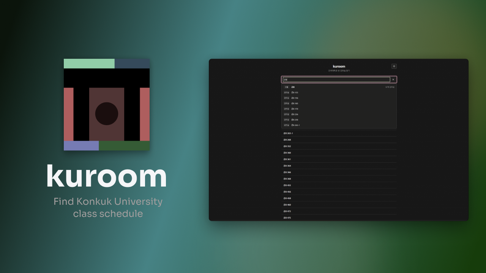

# KUROOM

건국대학교 강의실의 주간 시간표를 조회하고, 선택한 요일·시간에 수업이 없는 강의실을 찾는 웹 서비스입니다. 학교 시간표를 Python으로 수집·정제하고, 브라우저에서 정적 JSON 데이터를 검색합니다.

## 시연 영상

[](https://youtu.be/iZvaG1DglfI)

## 주요 기능

- 강의실 번호·건물 검색과 여러 검색 대상의 동시 조회
- 강의실별 주간 시간표, 수업 중 상태와 다음 수업 확인
- 요일·시간·최소 공실 시간·복수 건물 조건으로 빈 강의실 검색
- 검색 조건을 URL에 저장하고 공유
- 서울 시간대와 주간 경계를 반영한 시간 계산
- 모바일 화면과 키보드 조작을 지원하는 반응형 UI

## 실행

Node.js와 npm을 설치한 뒤 다음 명령을 실행합니다.

```sh
cd web
npm ci
npm run dev
```

터미널에 표시된 로컬 주소로 접속합니다. 기본 데이터는 `data/releases/2026_B01012/`의 강의실 404개·시간표 3,087개이며, Vite가 정적 파일로 제공합니다.

## 구현 구조

| 경로 | 역할 |
| --- | --- |
| `ku_room_scan.py` | 학교 시간표 수집 |
| `build_room_master.py`, `build_release.py` | 강의실 정규화와 학기별 JSON 생성 |
| `availability.py`, `data_loader.py`, `periods.py` | Python 조회·시간 계산과 데이터 로딩 |
| `web/src/` | TypeScript 검색 엔진·강의실 조회·시간표 UI |
| `data/releases/` | 브라우저에서 사용하는 정적 데이터 |

Python 기준 엔진과 TypeScript 엔진에 같은 질의를 적용해 상태와 정렬 결과를 비교합니다. 웹 UI·URL·검색 의미론의 자세한 설명은 [웹 README](web/README.md)에 정리했습니다.

## 검증

```sh
cd web
npm test
npm run test:timezones
npm run build
```

`npm test`는 Python 비교 테스트를 포함하므로 PATH에서 `python`을 실행할 수 있어야 합니다. 별도 실행 경로는 `PYTHON` 환경 변수로 지정할 수 있습니다. Python 테스트는 저장소 루트에서 실행합니다.

```sh
python -m unittest discover -s tests -v
```

## 데이터 범위

표시하는 것은 등록된 수업 일정입니다. 실제 점유·대관·휴일·학기 종료·건물 개방 여부나 공간 사용 권한은 보장하지 않습니다. 주간 시간표를 반복하는 모델이며, 새 학기에는 데이터 갱신이 필요합니다.
